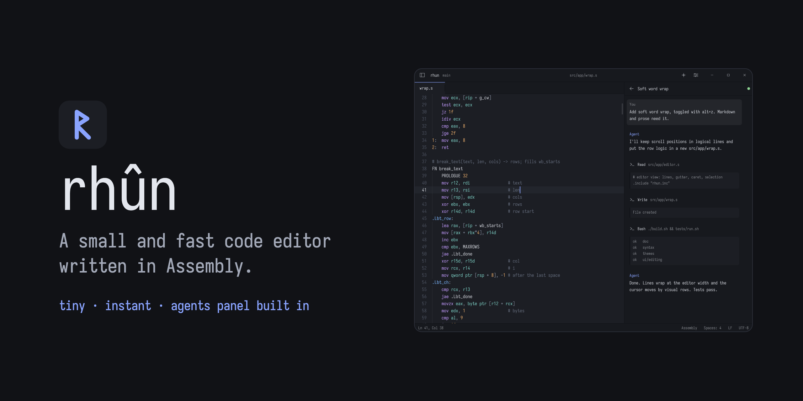
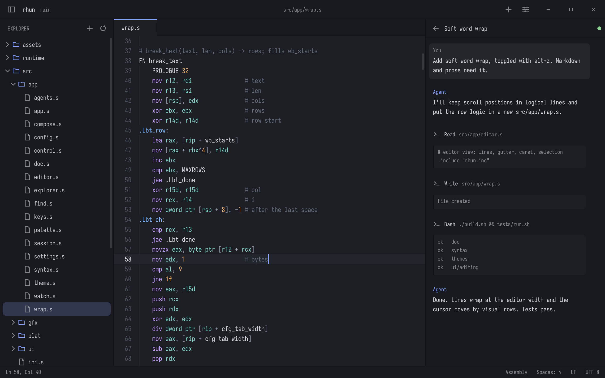
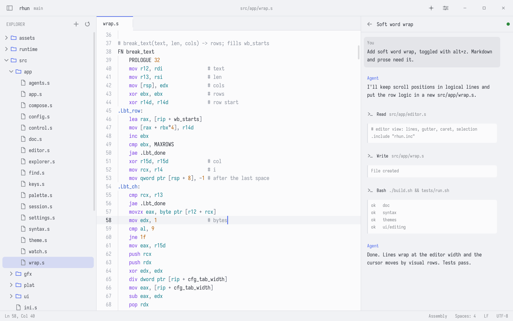
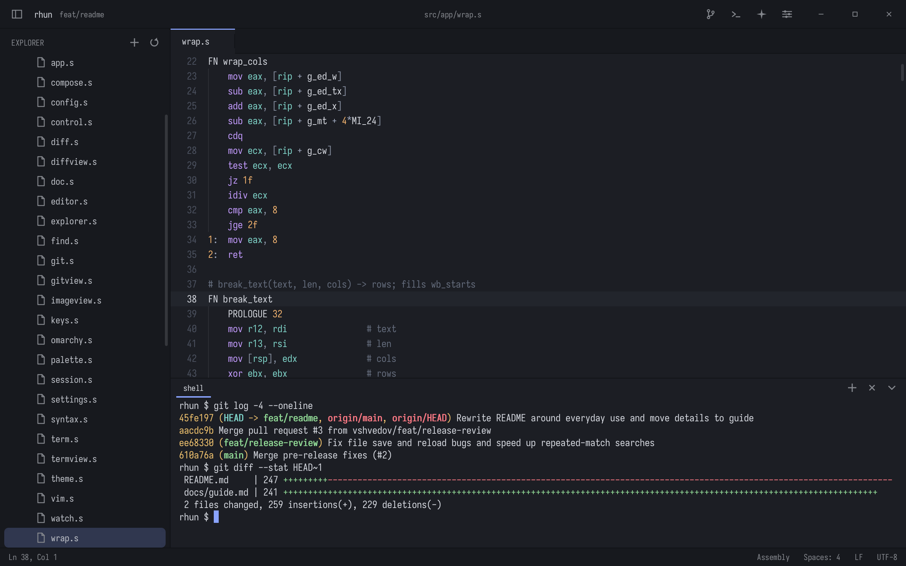
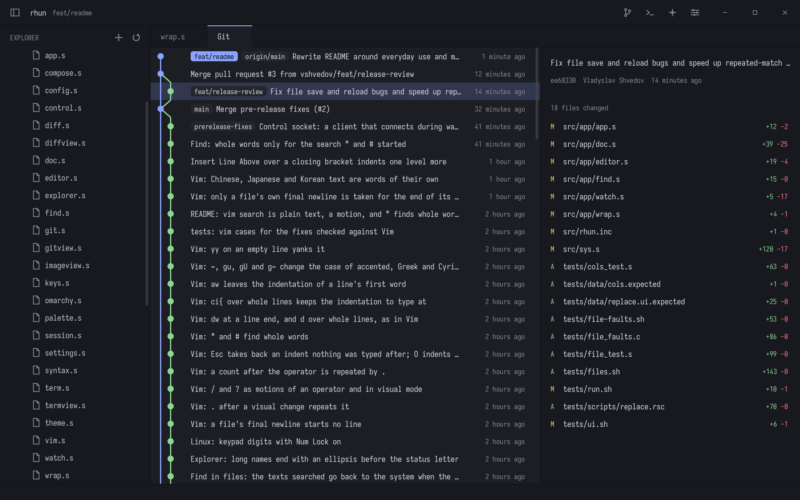

# raftaar

> Raftaar is a fork of [rhun](https://github.com/vshvedov/rhun) by Vlad Shvedov (MIT, see `LICENSE`).



[](https://discord.gg/Aj4drpFbWf)
[](https://www.producthunt.com/products/raftaar)
[](https://x.com/r13)

## Get raftaar

On Linux (x86-64) or macOS (Apple silicon), run:

```sh
curl -fsSL https://github.com/vshvedov/rhun/releases/latest/download/install.sh | sh
```

Or use `wget`:

```sh
wget -qO- https://github.com/vshvedov/rhun/releases/latest/download/install.sh | sh
```

On Windows 10 (1809 or later) or Windows 11:

```powershell
powershell -NoProfile -ExecutionPolicy Bypass -Command "& ([scriptblock]::Create((Invoke-WebRequest -UseBasicParsing https://github.com/vshvedov/rhun/releases/latest/download/install.ps1).Content))"
```

## Why raftaar

When coding agents do more of the heavy lifting, you may not need everything that comes with Vim, Sublime, VS Code, or Zed. You need to read and edit code, run commands, find files, and check what changed.

`raftaar` is perfect for such tasks: it is blazing fast, has a minimal memory and disk space footprint, and ships with everything you need:

- **Code editing:** Tabs, syntax highlighting, find and replace, and optional Vim mode.
- **Built-in terminal:** Run your shell, tools, and coding agents in tabs right beside the code, or split a tab into panes (Ctrl with an arrow).
- **Git:** Stage, commit, pull, and push; see changed files, read diffs, and browse commit history. Optionally draft commit messages with your Claude or Codex subscription, or a local Ollama model.
- **Fuzzy search:** Jump to a file or search across the whole project.

<p>
  
  
</p>

Pick from 40 light and dark themes, one for each mode: raftaar switches with your system's dark mode. On Omarchy, choose **Follow Omarchy**, and raftaar switches themes with your desktop.

Fast built-in terminal:

<p>
  
  
</p>

[Usage, shortcuts, and configuration](docs/guide.md)

## Contribute

`raftaar` welcomes new contributors. Pull requests are open to everyone: it doesn't matter whether a bug fix or a useful addition was created manually or using AI. Every fix matters.
Be reasonable, don't change the core functionality without starting [a discussion](https://github.com/vshvedov/rhun/discussions) first, and include a clear rationale for your PR.

As `raftaar` doesn't use any telemetry (and will *never* use it), we rely on users to report bugs. Encountered a crash? Something's not right? Please file a [bug report](https://github.com/vshvedov/rhun/issues) or fix it yourself and submit a PR.

A great place to start a new topic is raftaar's [Product Hunt forum](https://www.producthunt.com/p/raftaar) or [Discord](https://discord.gg/Aj4drpFbWf). [My X](https://x.com/r13) is the place where you can read human-written updates.

[MIT license](LICENSE).

Built-in font: [SIL Open Font License](assets/fonts/LICENSE-Iosevka.md).
