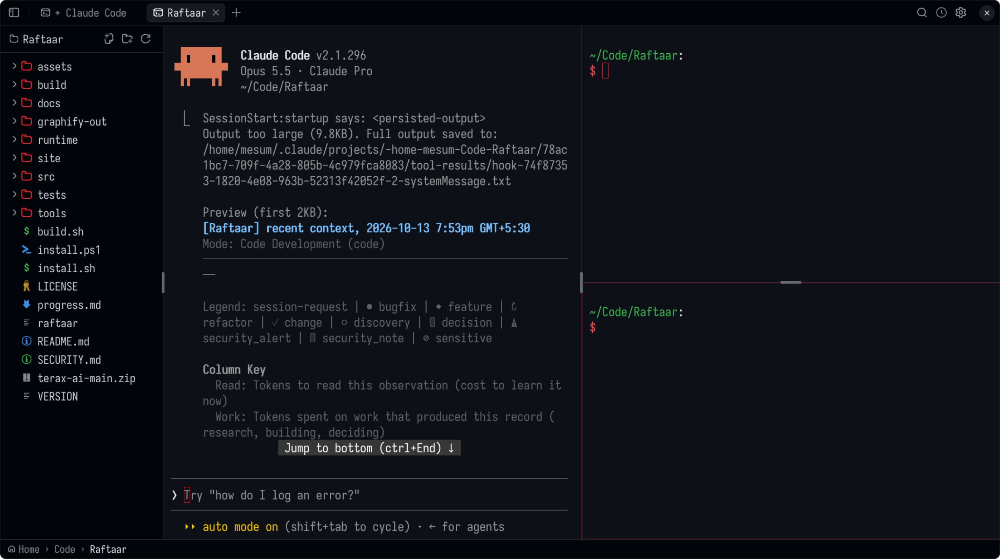

<p align="center">
  
</p>

<h1 align="center">Raftaar</h1>

<p align="center">
  <b>An extremely fast Terminal Development Environment written in Assembly.</b><br/>
  One 1 MB file. No runtime, no libc, no telemetry.
</p>

<p align="center">
  <a href="https://github.com/Mesum-Hussain/Raftaar/releases/latest"></a>
  
  <a href="LICENSE"></a>
</p>



***Raftaar*** (रफ़्तार) is the Hindi word for **Speed**.

## A Terminal Development Environment

IDEs like VS Code are built around files. The editor sits at the center, because for decades writing code meant typing it into files yourself, and the terminal is a panel docked below it.

AI changed where the work happens. Today you run Claude Code, Codex, Gemini, OpenCode or any of your favorite CLI coding agents in a terminal, tell them what to build, and review what they changed. The terminal is now the center of development, and the files are what you check.

Raftaar is built around that idea. It is a **TDE** (Terminal Development Environment): the terminal is the center, and around it are the three things a normal terminal app doesn't have:

- **A built-in file tree:** It tracks your shell's cwd: `cd` and the tree, git and new terminals follow. No shell hooks needed.
- **A built-in file viewer:** Open any file in a tab next to your terminals, with syntax highlighting for ~125 languages. When an agent edits it, it reloads and highlights the changed lines.
- **Built-in git:** Gutter diff markers, diffs against `HEAD`, and a history tab (Ctrl+Shift+G) with a commit graph of all branches, per-commit diffs, and stage, commit, pull and push.

Nothing more, which is why it launches in ~40 ms and idles at ~11 MB ([benchmarks](#benchmarks)).

## Why I built it

Two projects made me want this, and each got half of it right.

[Terax](https://github.com/crynta/terax-ai) had the UI I wanted: a terminal-first layout with a file tree, a file viewer and git around it. But it is built on a web stack, and a terminal is the one app that should never feel heavy.
[rhun](https://github.com/vshvedov/rhun) had the philosophy I wanted: extreme minimalism, to the point of being written entirely in assembly. But its UI is another VS Code clone, built around files rather than the terminal.

So I forked rhun and gave it Terax's UI. Raftaar is the result: rhun's engine with Terax's layout.

## Benchmarks

Raftaar 0.1.2 against Visual Studio Code 1.141.0, both opening the same folder (this repository).

| | Raftaar | VS Code | |
| --- | ---: | ---: | ---: |
| Download | 1.0 MB | 360 MB | 358× smaller |
| Installed size | 1.0 MB | 1,060 MB | 1,054× smaller |
| Installed files | 1 | 2,610 | |
| Launch to window | 41 ms | 564 ms | 14× faster |
| Memory, idle | 10.7 MB | 976 MB | 91× less |
| Processes, idle | 1 | 13 | |

<details>
<summary>How these were measured</summary>

- **Machine:** AMD Ryzen 5 7520U (8 threads), 14 GB RAM, Fedora 44, GNOME on Wayland. Measured on 13 October 2026.
- **Builds:** the `raftaar-0.1.2-linux-x86_64` release binary (1,005,600 bytes) and the official `code-stable-x64` tarball. Download is the size of each of those files; VS Code's installed size is the tarball unpacked. Launch and memory were measured on the same code built locally with `./build.sh release`.
- **Profiles:** both started with a fresh, empty profile. VS Code had no extensions installed, and its update check, telemetry and welcome page were turned off. Raftaar's update check was off too.
- **Launch to window:** time from starting the process to its window being viewable on X11. Both ran through XWayland (`RAFTAAR_BACKEND=x11`, `--ozone-platform=x11`) so one probe could time both. Median of 10 warm launches after 2 discarded ones. Raftaar ranged from 31 to 85 ms, VS Code from 512 to 576 ms. The endpoint is the window appearing, not the UI being ready for input.
- **Memory:** proportional set size (PSS) from `/proc/PID/smaps_rollup`, summed over the app's whole process tree 12 seconds after launch, with the folder open and no file or terminal open. Median of 3 launches.

One machine, one day: expect other numbers on yours, and roughly the same ratios.

</details>

## What you get

- **Terminals in tabs and panes.** 24-bit color, mouse, scrollback and full-screen programs. Ctrl with an arrow splits the active pane on that side. Drag the handle on the line between two panes to resize them, or double-click it to swap them.
- **A file tree** with file type icons and git status colors. It widens to fit the longest name and folds away when you drag it shut.
- **Clickable paths.** Ctrl+click a `file:LINE` in compiler output to open it at that line, or a URL to open it in the browser. The status bar's folders are buttons too: click one to `cd` there.
- **Git, without leaving the window.** Stage, commit, pull and push, read diffs, and browse history. Optionally draft commit messages with your Claude or Codex subscription, or a local Ollama model.
- **An editor when you need one.** Undo and redo, find and replace, find in files, and an optional Vim mode.
- **Find anything.** Fuzzy file finder and a command palette (Ctrl+Shift+P) that lists every command.
- **Markdown preview.** A Markdown file opens as a rendered page, with pictures, tables and colored code blocks. One switch (or Ctrl+Shift+V) shows its text to edit, in the same tab.
- **Image preview** for PNG, JPEG, GIF, BMP, ICO, QOI, PNM and TGA, with zoom and pan.
- **40 themes**, dark and light, that switch with your system's dark mode.
- **Zen mode** (Alt+Z): the tab or pane you are in, over the whole window, and nothing else.

Raftaar draws everything itself. It rasterizes its own fonts, icons and widgets into a pixel buffer, and on Linux it speaks the Wayland and X11 wire protocols directly, with no toolkit and no libc. About 97,000 lines of assembly, in one static binary.

## Install

**Linux** (x86-64):

```sh
curl -fsSL https://github.com/Mesum-Hussain/Raftaar/releases/latest/download/install.sh | sh
```

Or with `wget`:

```sh
wget -qO- https://github.com/Mesum-Hussain/Raftaar/releases/latest/download/install.sh | sh
```

The installer needs no root. It verifies the download's SHA-256, puts `raftaar` in `~/.local/bin`, and adds it to your applications menu.

Prefer to do it by hand? The Linux release is the program alone. Download `raftaar-VERSION-linux-x86_64` from [Releases](https://github.com/Mesum-Hussain/Raftaar/releases/latest), `chmod +x` it, and run it from anywhere. `raftaar --install-desktop` adds the menu entry and icons.

**Windows** 10 (1809 or later) and 11, x64:

```powershell
powershell -NoProfile -ExecutionPolicy Bypass -Command "& ([scriptblock]::Create((Invoke-WebRequest -UseBasicParsing https://github.com/Mesum-Hussain/Raftaar/releases/latest/download/install.ps1).Content))"
```

**macOS** has no release yet: the app needs a signing certificate that this project does not have.

Then run it:

```sh
raftaar            # reopen the last project
raftaar ~/code/app # open a folder
```

Raftaar updates itself: when a new version is out, the status bar offers it.

## Keys worth knowing

| Key | Action |
| --- | --- |
| Ctrl+T | New terminal in a tab |
| Ctrl+Arrow | Split the active pane on that side |
| Ctrl+Shift+Tab | Move to the next pane, clockwise |
| Ctrl+W | Close the tab or pane |
| Ctrl+\` | Show or hide the file tree |
| Ctrl+Shift+T | New file in the current folder |
| Ctrl+Shift+P | Command palette |
| Ctrl+Shift+F | Find in files |
| Ctrl+Shift+G | Git history and source control |
| Alt+Z | Zen mode |

Every key can be rebound in `~/.config/raftaar/config`. The [guide](docs/guide.md) covers all shortcuts, settings, themes, language grammars and scripting.

## Build from source

Linux on x86-64 needs only GNU `as` and `ld` (binutils):

```sh
./build.sh           # build/raftaar, with debug symbols
./build.sh release   # stripped
tests/run.sh         # unit tests and scripted UI tests
```

See the [guide](docs/guide.md#build) for Windows and macOS builds.

## Contribute

Pull requests are open to everyone, whether written by hand or with an agent. Include a clear rationale, and start [a discussion](https://github.com/Mesum-Hussain/Raftaar/discussions) before changing core behavior.

Raftaar has no telemetry and never will, so bug reports are the only way it learns about a crash. Please [file an issue](https://github.com/Mesum-Hussain/Raftaar/issues), or fix it and send a PR.

## Credits and license

Raftaar is a fork of [rhun](https://github.com/vshvedov/rhun) by Vlad Shvedov, and its layout follows [Terax](https://github.com/crynta/terax-ai). Thank you to both.

[MIT license](LICENSE). The built-in font is Iosevka, under the [SIL Open Font License](assets/fonts/LICENSE-Iosevka.md). The file icons are from Seti UI ([MIT](assets/icons/files/LICENSE-Seti.md)) and the window icons from Hugeicons ([MIT](assets/icons/hugeicons/LICENSE.md)).
